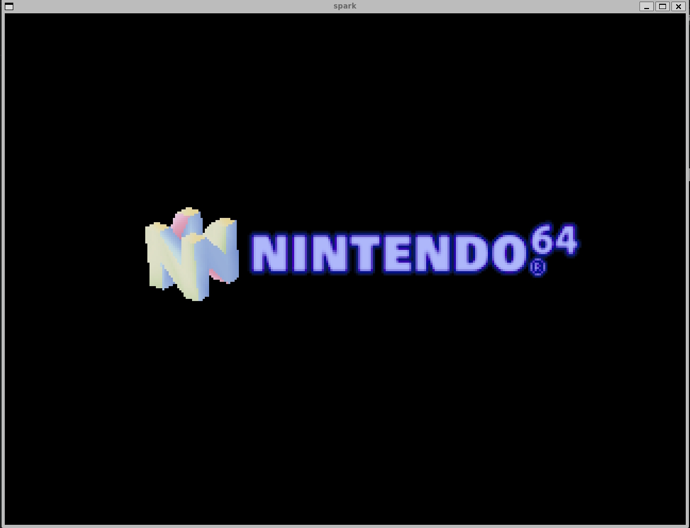
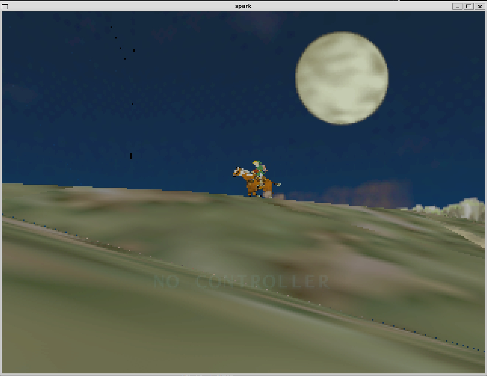
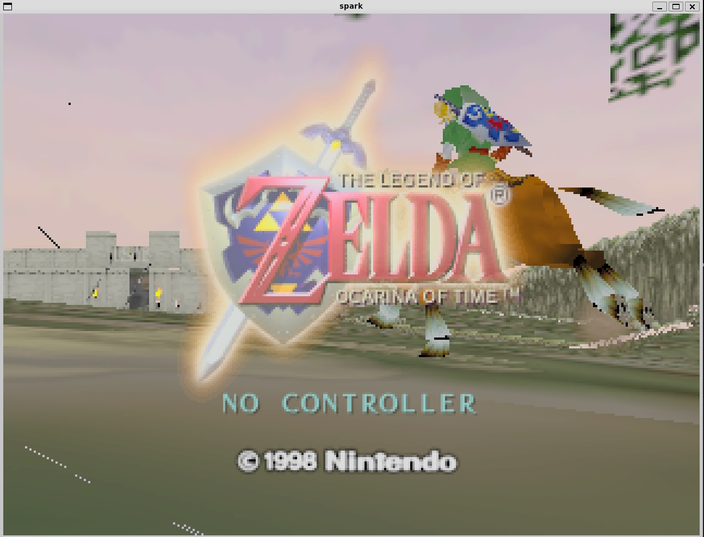

# Spark

A Nintendo 64 emulator written in modern C++.

This is an educational project.  
The goal is to eventually implement an emulator capable of playing retail games at full speed with reasonable visual accuracy.

## Current Status

**Supported Platforms:**
- Windows
- Linux (Ubuntu)
- macOS

Able to boot into Ocarina of Time and perform basic rendering with Vulkan.

Performance is currently poor.

https://youtube.com/watch?v=l297wPUB-O4





## Building

This project requires the gcc-16 compiler as it uses modules, contracts and reflection (C++26).  
Some or all of these features are not yet available in Clang/MSVC.

Vulkan 1.4 is required.

### Ubuntu
Install with `apt`:
- gcc-16
- cmake=4.2.3
- ninja-build
- libvulkan-dev
- vulkan-tools
- vulkan-validationlayers
- glslc
- qt6-base-dev
- qt6-wayland

You *may* want to run the application with `QT_QPA_PLATFORM=xcb`. This is recommended for WSL.

### Windows
Install MSYS2, and then use it to install these packages:
- gcc (`mingw-w64-ucrt-x86_64-gcc`)
- CMake (`mingw-w64-ucrt-x86_64-cmake`)
- Ninja (`mingw-w64-ucrt-x86_64-ninja-1.13.2-1`)
- Vulkan SDK (`mingw-w64-ucrt-x86_64-vulkan-utility-libraries`)
- shaderc (`mingw-w64-ucrt-x86_64-shaderc`)
- Qt6 (`mingw-w64-ucrt-x86_64-qt6-tools`)

### macOS
Install Xcode tools:
```bash
xcode-select --install
``` 
Install with brew:
- gcc@16
- cmake
- ninja
- vulkan-loader
- vulkan-tools
- vulkan-validationlayers
- shaderc

Then build [Qt](https://github.com/qt/qt5) from source (using GCC) with MoltenVK support.
```bash
mkdir build
cd build
SDKROOT=/Library/Developer/CommandLineTools/SDKs/MacOSX.sdk LIBRARY_PATH=/Library/Developer/CommandLineTools/SDKs/MacOSX.sdk/usr/lib VULKAN_SDK="$(brew --prefix)" ../configure -vulkan -DCMAKE_CXX_COMPILER=/opt/homebrew/bin/g++-16 -platform macx-g++
cmake --build . --parallel
sudo cmake --install .
```

On macOS, CMake configures the app bundle with the Homebrew Vulkan loader and validation-layer paths.
After building, launch `n64emu.app` from Finder; no shell environment setup is needed.
`QT_VULKAN_LIB` points to the Vulkan loader linked by the application, not directly to `libMoltenVK.dylib`.
When launched from Finder, the app also looks for an optional PIF ROM in its bundled `Contents/MacOS/data` directory.
